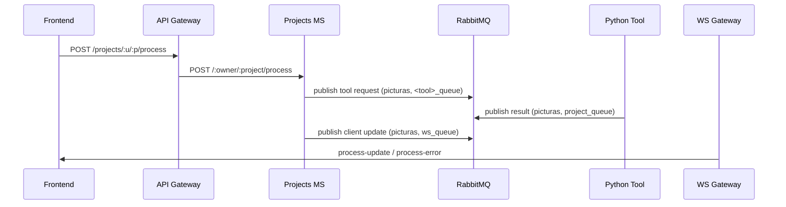
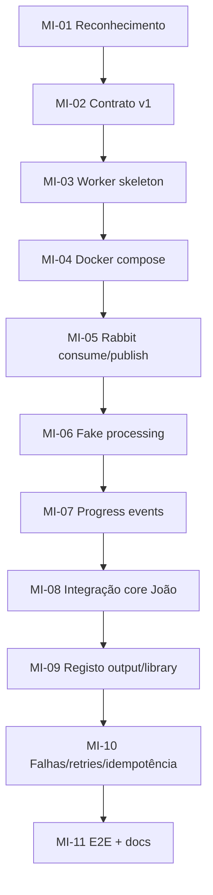

# PictuRAS — Auditoria de Arquitetura e Plano de Implementação para Funcionalidades de Vídeo

## 1) Executive summary

Este documento é uma auditoria técnica **baseada no repositório real** para preparar importação e conversão de vídeo sem implementar a feature nesta fase.

### Estado atual (verificado)
- A plataforma está estruturada em microserviços com `frontend` (Next.js), `apiGateway`, `projects`, `users`, `subscriptions`, `imageStorageService`, `wsGateway`, RabbitMQ e SeaweedFS (`docker-compose.yaml:5-542`, `README.md:62-153`).
- O pipeline atual é orientado a **imagem**: o `projects` publica pedidos para filas de tools Python e recebe respostas de resultado no `project_queue` (`projects/utils/project_msg.js:25-39`, `rabbitMQ/definitions.json:35-334`).
- O frontend recebe updates por Socket.IO via `ws_queue`, com eventos de alto nível (`process-update`, `preview-ready`, `process-error`) e **não** progresso real contínuo por percentagem da tool (`wsGateway/index.js:54-111`, `frontend/app/dashboard/[pid]/page.tsx:276-417`).
- O storage está desenhado para estágios `src|preview|preview_cache|out` e gera presigned URLs S3 (SeaweedFS) (`imageStorageService/utils/stages.js:1`, `imageStorageService/route/images.js:10-31`, `imageStorageService/services/getPresignedUrl.js:3-26`).
- Quotas/daily ops estão no `users` para operações avançadas de imagem (`users/routes/users.js:130-173`, `users/routes/users.js:317-363`) e são acionadas pelo `projects` em `POST /:user/:project/process` (`projects/routes/projects.js:1403-1648`).

### Conclusão arquitetural
A opção mais alinhada com o código existente é:

**Recomendação: Opção 3 (UI de vídeo no frontend existente + extensão das responsabilidades API/storage existentes + worker dedicado para FFmpeg).**

Isto maximiza reutilização de:
- autenticação/JWT no gateway,
- ownership e biblioteca no `projects`,
- storage S3 no `imageStorageService`,
- mensageria RabbitMQ já estabelecida,
- canal websocket já integrado no frontend.

---

## 2) Repository facts and limitations

## 2.1 Factos verificados
- Repositório monorepo com serviços separados (`README.md:361-384`).
- Compose centraliza runtime/configuração (`docker-compose.yaml:1-542`).
- RabbitMQ com exchange direta `picturas` e filas pré-definidas (`rabbitMQ/definitions.json:170-334`).
- Sem pasta de workflows CI no clone (`glob **/.github/workflows/*` sem resultados).

## 2.2 Limitações de evidência
- **Não foram encontrados documentos externos de use cases de vídeo** no repositório; a análise usa os requisitos do teu prompt como base de trabalho.
- Histórico Git local é muito curto (clone shallow): apenas commits recentes visíveis (`git log -n 15` devolveu 2 entradas).
- Não existe implementação atual de vídeo (tipos, endpoints, filas e UI são image-centric).

## 2.3 Classificação usada no documento
- **[VERIFICADO]** comportamento confirmado em ficheiros.
- **[INFERIDO]** inferência plausível com evidência parcial.
- **[PROPOSTA]** design novo recomendado.
- **[DECISÃO]** ponto que exige alinhamento explícito da equipa.

---

## 3) Architecture and service inventory

## 3.1 Estrutura principal
- `frontend/` Next.js + React + TS (`frontend/package.json:1-73`).
- `apiGateway/` Express proxy/autenticação (`apiGateway/app.js:1-44`).
- `projects/` domínio de projetos/pipeline/processamento (`projects/app.js:8-38`).
- `users/` autenticação/tipos/quota diária (`users/routes/users.js:121-173`).
- `subscriptions/` billing/plano premium (`subscriptions/routes/subscriptions.js:145-222`).
- `imageStorageService/` upload/delete/copy/presigned URLs (`imageStorageService/server.js:9-18`).
- `wsGateway/` eventos socket a partir do Rabbit (`wsGateway/index.js:54-111`).
- `Tools/` microserviços Python por tool (`Tools/border/border.py:33-77`, `Tools/text_ai/text_ai.py:56-126`).

## 3.2 Entry points runtime
- `projects`: `npm start` -> `node ./bin/www` HTTPS :9001 (`projects/package.json:5-7`, `projects/bin/www:16-35`).
- `users`: `npm start` -> `nodemon ./bin/www` (`users/package.json:5-7`).
- `api_gateway`: `npm start` (`apiGateway/package.json:5-7`).
- `frontend`: `bun start` produção (`frontend/Dockerfile:10-16`).
- `ws_gateway`: `node index.js` (`wsGateway/package.json:5-8`).

## 3.3 Stack técnico
- Node.js/Express, MongoDB/Mongoose, RabbitMQ AMQP, Python tools, Next.js React, SeaweedFS S3 (`README.md:107-153`).

---

## 4) Existing processing and storage flows

## 4.1 Fluxo frontend -> backend -> tools (imagem)



Evidência:
- publicação tool request (`projects/utils/project_msg.js:25-39`),
- consumo de `project_queue` em `process_msg` (`projects/routes/projects.js:152-487`),
- emissão para websocket via `ws_queue` (`projects/utils/project_msg.js:41-92`, `wsGateway/index.js:55-111`).

## 4.2 Contrato de mensagem atual tool request
[VERIFICADO] envelope atual usa:
- `messageId`, `timestamp`, `procedure`,
- `parameters.inputImageURI`, `parameters.outputImageURI`, `...params`
(`projects/utils/project_msg.js:25-36`).

## 4.3 Contrato de resposta da tool para projects
[VERIFICADO] `ToolMSG.send_msg` envia:
- `messageId`, `correlationId`, `timestamp`, `status`,
- `output.type`, `output.imageURI` (ou `error`)
(`Tools/utils/tool_msg.py:41-88`).

## 4.4 Storage atual
- Bucket por user: `user-<userId>` (`imageStorageService/services/uploadImage.js:6-13`).
- Chave: `<projectId>/<stage>/<uuid>.<ext>` (`uploadImage.js:9`).
- Stages permitidos: `src`, `preview`, `preview_cache`, `out` (`imageStorageService/utils/stages.js:1`).
- URLs internas vs públicas (`getPresignedUrl.js:3-26`).

## 4.5 Auth, permissões, quotas e ownership
- JWT validado no gateway (`apiGateway/auth/auth.js:3-42`).
- Share permissions e edit/read no `projects` (`projects/middleware/shareAuth.js:4-45`).
- Quota de operações avançadas no `users` (`users/routes/users.js:130-173`, `317-363`).
- Processamento com quota chamado pelo `projects` (`projects/routes/projects.js:1583-1648`).

## 4.6 Estado/cancelamento/retry atual
- Estado de execução por tokens (`activeToken`, `committedToken`, `prevCommittedToken`) no projeto (`projects/models/project.js:23-30`).
- Cancelamento invalida token ativo e remove processos/resultados desse token (`projects/routes/projects.js:2084-2188`).
- Não existe dead-letter/retry policy AMQP explícita nas definições (`rabbitMQ/definitions.json:35-334`).

## 4.7 Progresso atual
[VERIFICADO] o frontend calcula progresso por número de mensagens `process-update` vs total de passos, não por progresso real de execução media/video (`frontend/app/dashboard/[pid]/page.tsx:281-287`).

---

## 5) Análise dos dois use cases (import e conversão vídeo)

## 5.1 Video import

### O que já existe e pode ser reaproveitado
- Upload multipart de ficheiro para projeto (`projects/routes/projects.js:1171-1251`).
- Persistência de ownership por `user_id/project_id/imgs` (`projects/models/project.js:17-22`).
- Storage S3 com URL pública/privada (`imageStorageService/route/upload.js:8-34`, `route/images.js:10-31`).

### Lacunas para requisitos de vídeo
- [VERIFICADO] UI aceita só png/jpg/jpeg/zip (`frontend/components/app-dropzone.tsx:31-36`, `image-submission-area.tsx:21-27`).
- [VERIFICADO] metadados de imagem no projeto (`og_sha256`, `og_uri/new_uri`) sem modelo de vídeo dedicado (`projects/models/project.js:9-14`).
- [VERIFICADO] não há validação de codec/container de vídeo no backend atual.
- [INFERIDO] upload grande e cancelamento de upload não estão modelados no API atual (não há endpoint de multipart chunked nem abort token dedicado).

### Avaliação crítica
O use case de import vídeo **não está pronto para implementação direta** com os artefactos atuais sem:
1) evolução de contratos de upload, 2) validação técnica de vídeo, 3) metadados/biblioteca para vídeo, 4) regras claras de quota/limite.

## 5.2 Video conversion

### O que já existe e pode ser reaproveitado
- Orquestração assíncrona via Rabbit e estado por token (`projects/routes/projects.js:1377-1650`, `2084-2188`).
- Abstração de envio `send_msg_tool` e receção `process_msg` (`projects/utils/project_msg.js:25-39`, `projects/routes/projects.js:152-487`).
- Canal websocket para estados e erros (`wsGateway/index.js:79-109`).

### Lacunas para requisitos de vídeo
- [VERIFICADO] não há queue/procedure `video_convert` em `definitions.json` (`rabbitMQ/definitions.json:35-334`).
- [VERIFICADO] payload e semântica atuais são de `inputImageURI/outputImageURI` (`projects/utils/project_msg.js:31-35`).
- [VERIFICADO] progresso real (FFmpeg frame/time) não existe no contrato websocket atual.
- [VERIFICADO] registo de resultados está orientado a imagem/texto (`projects/models/result.js:3-11`).

### Avaliação crítica
A base de orquestração existe, mas a conversão vídeo requer contrato novo/versionado, metadata de vídeo, estados de job mais ricos, e separação explícita entre execução técnica e registo de output.

---

## 6) Arquiteturas alternativas e recomendação

## 6.1 Opção 1 — Estender serviços existentes, worker dedicado só se necessário
- Prós: menor overhead de serviços.
- Contras: risco de acoplamento excessivo no `projects` se FFmpeg ficar lá dentro.

## 6.2 Opção 2 — Serviços separados de import e conversão
- Prós: fronteiras explícitas.
- Contras: custo operacional alto, duplicação de auth/quota/library se mal desenhado.

## 6.3 Opção 3 — UI integrada + extensão de API/storage + worker dedicado FFmpeg
- Prós: reutiliza gateway/auth/library/storage/rabbit/ws já existentes.
- Contras: exige disciplina contratual para não “vazar” lógica de vídeo para camadas erradas.

## 6.4 Recomendação
**[PROPOSTA] Escolher Opção 3.**

### Fronteiras recomendadas
- `frontend`: UX vídeo (import/conversão/status/progresso/cancelamento).
- `apiGateway`: autenticação e forwarding.
- `projects`: ownership, biblioteca, validação de permissões, criação/estado de jobs, registo final de outputs.
- `imageStorageService`: armazenamento e URLs.
- `video-conversion-worker` (novo): consumo Rabbit, invocação core FFmpeg, publicação de progresso/resultado.
- Core FFmpeg (João): biblioteca interna chamada pelo worker, sem Rabbit/db/auth.

---

## 7) Contracts and integration design (proposta)

> Nota: secção totalmente **[PROPOSTA]** para permitir desenvolvimento paralelo.

## 7.1 API HTTP (frontend -> gateway -> projects)

### Criar import de vídeo
`POST /projects/:user/:project/video`
- multipart `file`
- headers: `Authorization`, `X-Project-Version`
- resposta: `201` com `{ itemId, mediaType:"video", format, sizeBytes, durationMs?, width?, height? }`

### Criar job de conversão
`POST /projects/:user/:project/video/:itemId/convert`
- body: `{ targetFormat?: "mp4"|"webm"|"mkv"|"mov", targetResolution?: "1080p"|"720p"|... , keepOriginal: true }`
- resposta: `202` com `{ jobId, state:"queued" }`

### Consultar job
`GET /projects/:user/:project/jobs/:jobId`
- resposta: `{ state, progressPercent, currentStep, error?, outputItemId? }`

### Cancelar job
`DELETE /projects/:user/:project/jobs/:jobId`
- resposta `204`

## 7.2 RabbitMQ schema (worker)

### Request event
```json
{
  "schemaVersion": 1,
  "messageId": "uuid",
  "correlationId": "jobId",
  "timestamp": "ISO-8601",
  "procedure": "video_convert",
  "authContext": { "ownerId": "...", "runnerId": "..." },
  "resource": {
    "input": { "bucket": "user-...", "key": "<project>/src/<file>", "mediaType": "video" },
    "output": { "bucket": "user-...", "prefix": "<project>/out/" }
  },
  "parameters": {
    "targetFormat": "mp4",
    "targetResolution": "720p",
    "keepOriginal": true
  },
  "idempotencyKey": "jobId"
}
```

### Progress event
```json
{
  "schemaVersion": 1,
  "messageId": "uuid",
  "correlationId": "jobId",
  "type": "video-convert-progress",
  "timestamp": "ISO-8601",
  "progress": {
    "percent": 42,
    "frame": 1234,
    "timeMs": 55321,
    "fps": 28.4,
    "etaMs": 74000
  },
  "state": "processing"
}
```

### Result/failure event
```json
{
  "schemaVersion": 1,
  "messageId": "uuid",
  "correlationId": "jobId",
  "type": "video-convert-result",
  "timestamp": "ISO-8601",
  "state": "completed",
  "output": {
    "bucket": "user-...",
    "key": "<project>/out/<generated>.mp4",
    "format": "mp4",
    "width": 1280,
    "height": 720,
    "durationMs": 120000,
    "sizeBytes": 12345678
  }
}
```

Erro:
```json
{
  "schemaVersion": 1,
  "messageId": "uuid",
  "correlationId": "jobId",
  "type": "video-convert-result",
  "timestamp": "ISO-8601",
  "state": "failed",
  "error": { "code": "FFMPEG_EXEC_FAILED", "message": "...", "retryable": false }
}
```

## 7.3 Estados de job
`queued -> processing -> completed|failed|cancelled`

Regras:
- ACK AMQP confirma receção técnica da mensagem no worker.
- Estado de negócio (processing/completed/failed/cancelled) é separado e persistido no `projects`.
- Progresso visível ao utilizador vem de eventos `video-convert-progress`.

## 7.4 Idempotência e correlação
- `correlationId = jobId` obrigatório.
- `idempotencyKey = jobId` para ignorar duplicados.
- Worker deve ser tolerante a redelivery (at-least-once).

## 7.5 Semântica URI storage
[DECISÃO] Evitar paths locais cross-container como contrato primário.

Usar `bucket+key` S3 no contrato; paths locais só internos ao worker após download temporário.

---

## 8) Frontend developer — tutorial explícito (standalone)

## 8.1 Missões

| ID | Objetivo | Porque | Ficheiros a inspecionar | Ficheiros a criar/alterar | DoD |
|---|---|---|---|---|---|
| FE-01 | Mapear arquitetura atual da página de projeto | Evitar integração fora do fluxo existente | `frontend/app/dashboard/[pid]/page.tsx`, `frontend/providers/project-provider.tsx`, `frontend/lib/projects.ts` | nenhum | mapa de estados/events documentado |
| FE-02 | Criar tipos de vídeo no cliente | Evitar uso de `any` | `frontend/lib/projects.ts`, `frontend/lib/tool-types.ts` | `frontend/lib/projects.ts` | interfaces `VideoItem`, `VideoJob` disponíveis |
| FE-03 | Integrar ações de vídeo na biblioteca | Reutilizar experiência atual de grid/carousel | `frontend/components/project-page/project-image-list.tsx`, `project-image.tsx` | novos componentes `project-video.tsx` (proposto) | vídeos listados sem quebrar imagens |
| FE-04 | Import UI de vídeo | requisito funcional de entrada | `image-submission-area.tsx`, `app-dropzone.tsx`, `add-images-dialog.tsx` | novo diálogo `add-videos-dialog.tsx` (proposto) | aceita mp4/webm/mkv/mov com validação UI |
| FE-05 | UI de opções de conversão | permitir pedir conversão | `toolbar/*.tsx`, `mode-toggle.tsx` | `components/video/video-convert-dialog.tsx` (proposto) | payload enviado conforme contrato |
| FE-06 | Exibir metadados vídeo | transparência para utilizador | página de projeto + card de media | componentes de metadata | formato/resolução/duração visíveis |
| FE-07 | Ligar API client | usar camada central `lib/projects.ts` | `frontend/lib/projects.ts`, `lib/mutations/projects.ts`, `lib/queries/projects.ts` | funções `createVideoImport`, `createVideoConversionJob`, `getVideoJob` | chamadas com token/owner/share/version |
| FE-08 | Estados de job | UX consistente | `page.tsx`, `project-provider.tsx` | UI de `queued/processing/completed/failed/cancelled` | estado refletido sem refresh manual |
| FE-09 | Progresso real | requisito explícito | `useGetSocket` e listeners em `page.tsx` | novos listeners de evento vídeo | barra atualiza por `percent` real |
| FE-10 | Erros/cancelamento/loading | robustez | `error-messages.ts`, `page.tsx` | mapping de erros vídeo | UX com mensagens claras |
| FE-11 | Preservar original + mostrar output novo | regra de negócio | `project-image-list.tsx`, results mode | ajustar listagem de resultados | original e convertido coexistem |
| FE-12 | Mock para desenvolvimento sem worker | paralelismo da equipa | `lib/projects.ts` + camada de mock | fixture/mock adapter | frontend testável sem backend final |
| FE-13 | Verificação final | qualidade | `frontend/package.json` scripts | nenhum | `bun run lint` e `bun run build` passam |

## 8.2 Erros comuns
- Esquecer `owner/share` query em fluxos de projeto partilhado (`frontend/lib/projects.ts:7-19`, `193-199`).
- Não propagar `X-Project-Version`, causando `409` (`projects/middleware/projectVersion.js:3-17`).
- Assumir progresso “real” do backend quando hoje é por contagem de eventos (`frontend/app/dashboard/[pid]/page.tsx:281-287`).

## 8.3 Checklist ordenada
1. FE-01, FE-02
2. FE-07
3. FE-04 + FE-05
4. FE-08 + FE-09 + FE-10
5. FE-11 + FE-12
6. FE-13

**Primeira tarefa recomendada (frontend): FE-01.**

---

## 9) Playbook gamificado (ADHD-friendly) — integração worker/Rabbit/infra

## 9.1 Mission map



### Dependências
- Pode começar já: MI-01..MI-07.
- Bloqueado por João: MI-08 (adapter final do core).
- Bloqueado por import/storage: parte final de MI-09 (metadados definitivos).
- Bloqueado por frontend: validação end-to-end de eventos UI (MI-11).

## 9.2 Implementation campaign

### MI-01 — Reconhecimento
- Objetivo: identificar abstrações reutilizáveis.
- Complexidade: S.
- Ações:
  1. Mapear `send_msg_tool/read_msg` e `ToolMSG`.
  2. Mapear tokens de cancelamento no `projects`.
- Ficheiros: `projects/utils/project_msg.js`, `Tools/utils/tool_msg.py`, `projects/routes/projects.js`.
- DoD: mapa de interfaces fechado.

### MI-02 — Contrato v1
- Objetivo: congelar schema mínimo.
- Complexidade: M.
- Dependências: MI-01.
- Ações:
  1. Definir `video_convert` request/result/progress/error.
  2. Definir estados `queued/processing/...`.
- DoD: contrato aprovado por ti + João + frontend.

### MI-03 — Worker skeleton
- Objetivo: serviço novo sem lógica FFmpeg real.
- Complexidade: M.
- Dependências: MI-02.
- Ações:
  1. Criar pasta do worker (ex.: `Tools/video_convert/` ou novo serviço dedicado).
  2. Reutilizar `Tools/utils/rabbit_mq.py`/`tool_msg.py` ou implementar wrapper equivalente robusto.
- DoD: arranca e consome fila.

### MI-04 — Registo no compose
- Objetivo: ligar runtime.
- Complexidade: S.
- Dependências: MI-03.
- Ações:
  1. Adicionar serviço no `docker-compose.yaml`.
  2. Adicionar fila/binding em `rabbitMQ/definitions.json`.
- DoD: container healthy e fila criada.

### MI-05 — Rabbit consume/publish
- Objetivo: handshake completo.
- Complexidade: M.
- Dependências: MI-04.
- Ações:
  1. Consumir `video_convert_queue`.
  2. Publicar `video-convert-progress` e `video-convert-result`.
- DoD: mensagens visíveis no management UI.

### MI-06 — Fake processing
- Objetivo: desbloquear integração sem FFmpeg.
- Complexidade: S.
- Dependências: MI-05.
- Ações:
  1. Simular progresso incremental.
  2. Produzir output mock validado.
- DoD: frontend e projects conseguem testar fluxo completo.

### MI-07 — Progress + cancelamento
- Objetivo: estado robusto.
- Complexidade: M.
- Dependências: MI-06.
- Ações:
  1. Consumir sinal de cancelamento lógico (token/job state).
  2. Publicar `cancelled` de forma idempotente.
- DoD: cancelamento reproduzível sem estado órfão.

### MI-08 — Adapter para core de João
- Objetivo: plugar FFmpeg real.
- Complexidade: M.
- Dependências: MI-02 + interface de João.
- Ações:
  1. Chamar função de core com callback de progresso.
  2. Traduzir exceções para erro contratual.
- DoD: worker usa core sem conhecer detalhes internos.

### MI-09 — Registo de output e ownership
- Objetivo: output na biblioteca sem sobrescrever original.
- Complexidade: L.
- Dependências: MI-08 + equipa import/storage.
- Ações:
  1. Persistir item convertido com owner correto.
  2. Garantir atomicidade conversão->registo (ou compensação).
- DoD: item convertido aparece como novo artefacto.

### MI-10 — Resiliência
- Objetivo: evitar duplicações/fugas.
- Complexidade: M.
- Dependências: MI-09.
- Ações:
  1. Idempotência por `jobId`.
  2. Retry policy + dead-letter strategy.
  3. Limpeza de temporários em sucesso/falha/cancelamento.
- DoD: testes de falha passam.

### MI-11 — E2E + documentação
- Objetivo: fechar MVP.
- Complexidade: M.
- Dependências: MI-10.
- Ações:
  1. Demo mínima import->convert->resultado.
  2. Atualizar docs de contratos e runbook.
- DoD: demo reproduzível + checklist de aceitação.

### XP/Badges (leve)
- Badge Bronze: MI-01..MI-04
- Badge Silver: MI-05..MI-07
- Badge Gold: MI-08..MI-11

## 9.3 Integração arquitetura (teu foco)
- Config/deps: centralizar variáveis de Rabbit/storage no serviço novo (padrão `Tools/utils/env.py:6-10`, corrigindo erros de naming quando necessário).
- Networking/volumes: validar montagens; **não assumir** path partilhado sem volume comum.
- Rabbit lifecycle: ligação resiliente, consumo manual ack, publicação com correlation.
- Message validation: validar schema antes de processar.
- Delegação: worker chama interface de João e mantém responsabilidade de publicação Rabbit.
- Persistência/library registration: fica no domínio de aplicação (`projects`), não no core FFmpeg.

## 9.4 Tua primeira tarefa (única recomendada)
**MI-02 — Fechar contrato v1 `video_convert` com exemplos de request/progress/result/error e máquina de estados.**

Critério de conclusão: documento de contrato aprovado por ti + João + frontend, sem ambiguidades sobre campos obrigatórios, estados e cancelamento.

---

## 10) Playbook do João — core FFmpeg

## 10.1 Fronteira de responsabilidade
João implementa **core de conversão**; não implementa RabbitMQ/auth/db orchestration por defeito.

## 10.2 Interface proposta (callable)

```ts
convertVideo(input: {
  inputPath: string,
  outputPath: string,
  targetFormat?: "mp4"|"webm"|"mkv"|"mov",
  targetResolution?: "2160p"|"1440p"|"1080p"|"720p"|"480p",
  preserveUnchanged: true,
  timeoutMs?: number
}, callbacks: {
  onProgress?: (p: { percent?: number; frame?: number; timeMs?: number; fps?: number; etaMs?: number }) => void,
  isCancelled?: () => boolean
}): Promise<{
  outputPath: string,
  format: string,
  width: number,
  height: number,
  durationMs: number,
  sizeBytes: number,
  videoCodec?: string,
  audioCodec?: string
}>
```

## 10.3 Checklist João
1. Validar input com `ffprobe` (existência, streams, duração).
2. Resolver semântica format+codec suportada (MVP: subset claro).
3. Parse de resolução e preservação de aspect ratio.
4. Invocação subprocess sem shell-string insegura.
5. Extrair progresso real (parse de stderr/progress pipe).
6. Implementar cancelamento (`SIGTERM`/`SIGKILL` fallback).
7. Timeouts/resource limits.
8. Validar output final (arquivo existe, stream legível, metadados coerentes).
9. Cleanup de temporários.
10. Testes unitários com fixtures pequenas + testes de integração da interface.

## 10.4 MVP vs opcional
- MVP: mp4/webm/720p/1080p + progresso + cancelamento + validação.
- Opcional: matriz avançada codec/container, áudio multi-track, perf tuning GPU.

---

## 11) Import team playbook (conciso)

## 11.1 Extender vs substituir
[VERIFICADO] existe upload de ficheiros no `projects` e `imageStorageService` (`projects/routes/projects.js:1171-1251`, `imageStorageService/route/upload.js:8-34`).

[PROPOSTA] **estender** fluxo existente em vez de substituir:
- novo endpoint de vídeo no `projects` reutilizando `imageStorageService`.

## 11.2 Responsabilidades
- Validação container/codec/readability (não apenas extensão).
- Limites de tamanho e upload robusto para ficheiros grandes.
- Ownership + registo em biblioteca.
- Metadata extraction (duration, resolution, codecs) + thumbnail opcional.
- Cleanup de uploads falhados/abortados.

## 11.3 Contratos mínimos a acordar
- Payload de criação de item de vídeo.
- Campos obrigatórios de metadata persistida.
- Código de erro normalizado (format inválido, quota, unreadable media).

## 11.4 Aceitação
- Upload MP4/WebM/MKV/MOV válido.
- Rejeição clara de ficheiro inválido.
- Item aparece na biblioteca com owner correto.
- Cancelamento remove temporários/estado pendente.

---

## 12) Riscos e decisões em aberto (priorizado)

| Severidade | Tema | Evidência / falta | Consequência | Proposta | Responsável | Bloqueia? |
|---|---|---|---|---|---|---|
| Blocker | Dono da quota para vídeo | quota atual só advanced tools imagem (`users/routes/users.js:130-173`) | regras inconsistentes | definir owner único da quota (users + contrato) | backend leads | Sim |
| Blocker | Contrato format vs codec | inexistente no sistema atual | conversões inválidas/UX confusa | matriz suportada MVP | João + integração | Sim |
| High | Progresso real vs pseudo-progresso | frontend usa contagem de steps (`page.tsx:281-287`) | UX enganadora | evento progress dedicado | frontend + worker | Sim |
| High | Shared volume vs S3 key | proposta inicial usa paths locais; sistema real usa S3 presigned (`getPresignedUrl.js:3-26`) | falhas cross-container | contrato bucket/key | integração | Sim |
| High | Duplicados/retries | sem DLQ/retry explícitos (`definitions.json`) | outputs duplicados | idempotência por jobId + política retry | integração | Sim |
| High | Falha entre conversão e registo em biblioteca | fluxo atual não cobre vídeo | orfandade de ficheiros | transação lógica + compensação | projects team | Sim |
| Medium | Naming de output + preservação original | regra não fechada | overwrite acidental | naming determinístico + novo item | import+projects | Sim |
| Medium | Cleanup de disco temporário | limpeza parcial existe para imagens (`projects/routes/projects.js:2175-2180`) | crescimento disco | lifecycle cleanup explícito | integração | Não |
| Medium | Segurança opções de conversão | sem validação vídeo atual | injeção/abuso recursos | whitelist estrita de parâmetros | João + integração | Sim |
| Medium | Crash de container em job longo | não há recover flow documentado | job preso | heartbeat + requeue/reconcile | integração | Não |
| Low | Versionamento de schemas | inexistente | quebra entre equipas | `schemaVersion` obrigatório | todas equipas | Não |

### Decisões MVP obrigatórias
1. Contrato v1 de mensagens.
2. Matriz de formatos/codecs/resoluções suportados.
3. Estratégia de quota e limites.
4. Estratégia de idempotência/retry.
5. Semântica de cancelamento e estado final.

---

## 13) Team execution plan

## 13.1 Responsibility matrix (RACI simplificada)

| Área | Frontend dev | Tu (integração) | João (core) | Import/storage team |
|---|---|---|---|---|
| UI vídeo | R | C | I | C |
| API client vídeo | R | C | I | C |
| Contrato Rabbit | C | R | C | C |
| Worker infra Rabbit | I | R | C | I |
| Core FFmpeg | I | C | R | I |
| Import + metadata vídeo | C | C | I | R |
| Library registration vídeo | C | R | I | C |
| Websocket progresso | R | R | C | I |
| Quotas/regras | C | R | I | C |

## 13.2 Dependency graph
1. Contrato v1 aprovado.
2. Frontend e worker mock podem avançar em paralelo.
3. João implementa core contra interface estável.
4. Integração pluga core no worker.
5. Import team fecha metadata + registo final.
6. E2E demo.

## 13.3 Checkpoints
- CP1: contrato v1 assinado.
- CP2: worker mock + UI mock integrados.
- CP3: core FFmpeg integrado com progresso real.
- CP4: import + conversão + registo completo (demo).

## 13.4 Minimal E2E demo plan
1. Importar vídeo para biblioteca.
2. Pedir conversão (ex. mp4->webm 720p).
3. Observar estados `queued->processing->completed` com progresso.
4. Ver resultado novo na biblioteca mantendo original.
5. Cancelar um job e verificar cleanup/estado `cancelled`.

---

## 14) Shared acceptance criteria (feature global)

- [ ] Upload de MP4/WebM/MKV/MOV com validação real de legibilidade.
- [ ] Conversão assíncrona com progresso real consumível no frontend.
- [ ] Cancelamento funcional e idempotente.
- [ ] Original preservado; output registado como novo item do mesmo owner.
- [ ] Quota e permissões aplicadas de forma consistente.
- [ ] Falhas de FFmpeg/storage/db propagadas com erro estruturado.
- [ ] Limpeza de temporários e outputs parciais em falha/cancelamento.
- [ ] Contratos versionados e testáveis com mocks.

---

## 15) One recommended next action for ti

**Ação única recomendada:** convocar uma sessão curta de alinhamento técnico para fechar o **Contrato v1 de conversão de vídeo** (HTTP + Rabbit + estados de job + erros + cancelamento), e só depois iniciar implementação paralela.

Critério de concluído: contrato documentado e aprovado por ti, João, frontend e import/storage team.

---

## Anexo A — Inventário de referências principais

- Arquitetura geral: `README.md:62-153`, `docker-compose.yaml:39-542`
- Nginx rotas: `nginx/nginx.conf:21-129`
- Rabbit topology: `rabbitMQ/definitions.json:35-334`
- Gateway auth/routes: `apiGateway/auth/auth.js:3-42`, `apiGateway/routes/projects.js:87-863`
- Projects pipeline: `projects/routes/projects.js:152-2666`
- Mensageria projects/tools: `projects/utils/project_msg.js:25-109`, `Tools/utils/tool_msg.py:41-88`
- Websocket events: `wsGateway/index.js:54-111`
- Storage service: `imageStorageService/route/*.js`, `services/getPresignedUrl.js:3-26`
- Quotas users: `users/routes/users.js:130-173`, `317-363`
- Frontend page/API hooks: `frontend/app/dashboard/[pid]/page.tsx:61-870`, `frontend/lib/projects.ts:7-920`, `frontend/providers/project-provider.tsx:61-349`

